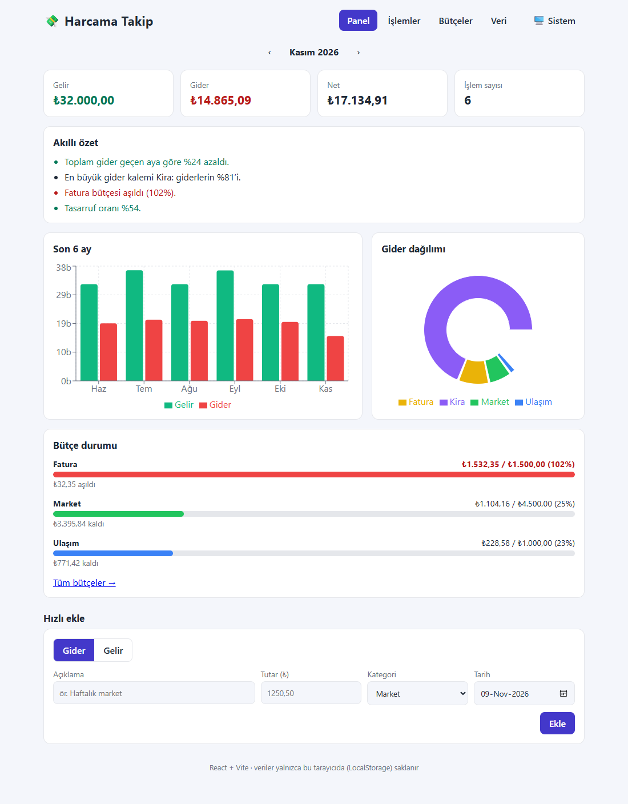
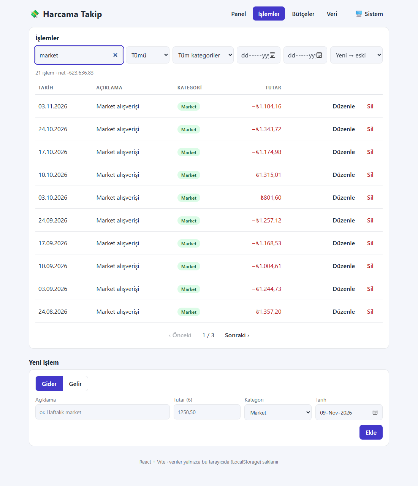
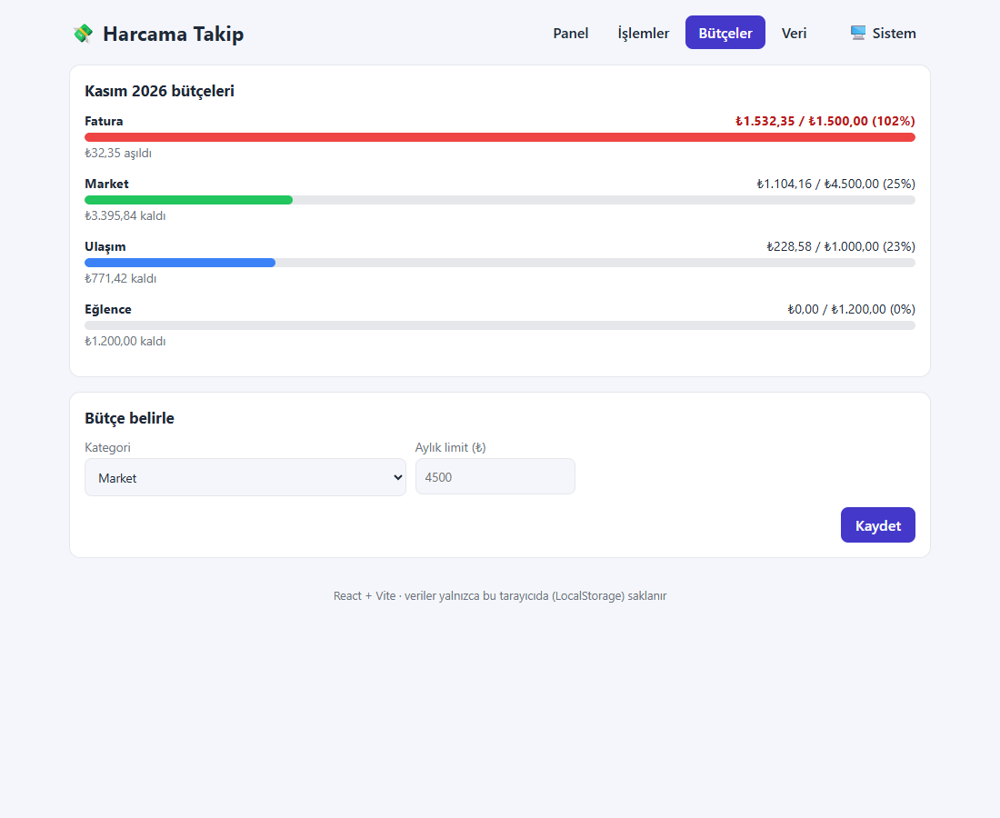
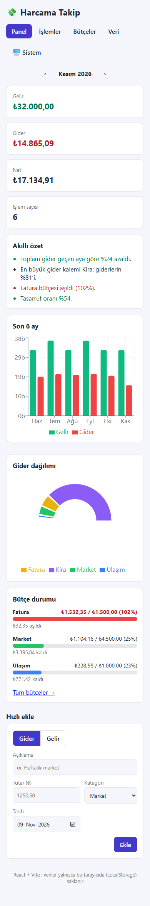
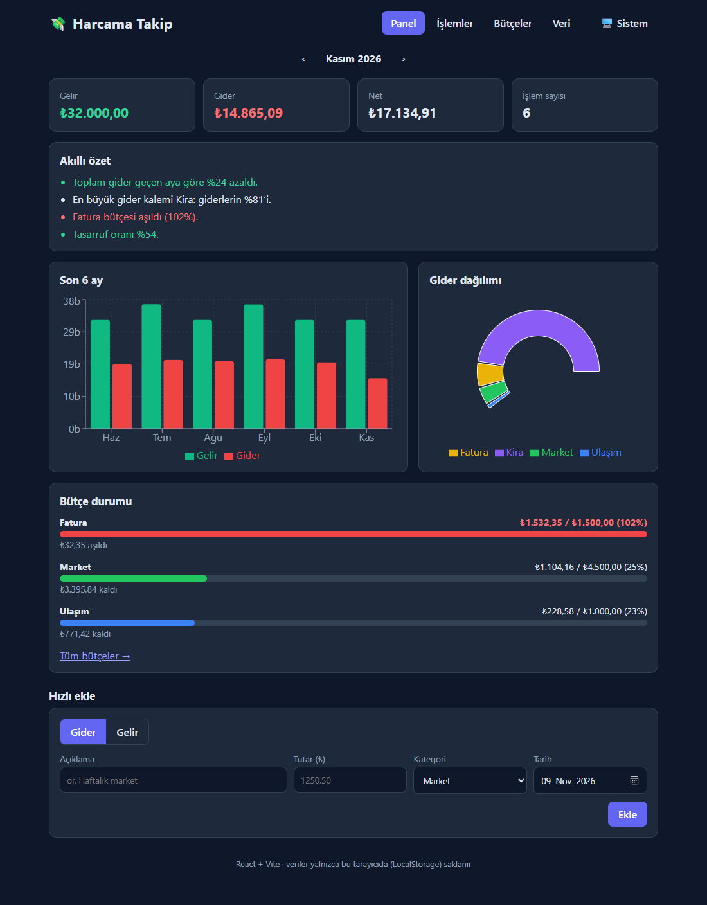

# 💸 Harcama Takip

React (Vite) ile yazılmış, gelir-gider takibi, bütçe uyarıları, grafikler ve kural tabanlı "akıllı özet" sunan çok sayfalı bir web uygulaması. Sunucu veya hesap gerekmez; veriler **LocalStorage**'da saklanır.



**Canlı bağlantı:** https://b4tukk.github.io/harcama-takip-react/ _(GitHub Actions ile otomatik yayınlanır)_

## Özellikler
- **Panel:** aylık gelir/gider/net, ay gezinmesi, son 6 ay çubuk grafiği, gider dağılımı halka grafiği, bütçe durumu, akıllı özet (ör. "Toplam gider geçen aya göre %24 azaldı", "Tasarruf oranı %54")
- **İşlemler:** ekleme, düzenleme (modal), silme + **geri al**, arama (Türkçe büyük/küçük harf duyarsız), tür/kategori/tarih aralığı filtresi, sıralama, sayfalama
- **Bütçeler:** kategori başına aylık limit, ilerleme çubuğu, %80 uyarı ve aşım durumu
- **Veri:** CSV/JSON dışa aktarma, CSV/JSON içe aktarma (satır bazlı hata raporu), örnek veri yükleme, tümünü silme
- Doğrulama (Türkçe tutar biçimi `1.250,50`), koyu/açık/sistem teması, mobil uyum, erişilebilirlik (aria etiketleri, odak halkası, klavye)
- Eski sürümün (v1) LocalStorage verisi otomatik v2 şemasına taşınır

## Teknolojiler
React 19, Vite, React Router (HashRouter), Recharts, `useReducer` + Context, saf CSS (CSS değişkenleri), Vitest + Testing Library, Oxlint, GitHub Actions (CI + Pages)

## Kurulum
```bash
npm install
npm run dev       # geliştirme
npm test          # 33 test
npm run lint
npm run build     # dist/
```

## Mimari
```
src/
  lib/        saf fonksiyonlar: validate, csv, selectors (toplamlar, bütçe, içgörü), format, sample
  store/      reducer (ADD/UPDATE/DELETE/UNDO/IMPORT/…), storage (şema v2 + v1 göçü), StoreContext
  components/ Layout, TransactionForm/Table, Charts
  pages/      Dashboard, Transactions, Budgets, DataPage
  test/       lib.test.js (29 birim testi), app.test.jsx (uçtan uca kullanıcı akışları)
```
İş mantığı arayüzden ayrıdır; bu yüzden testlerin çoğu bileşen render etmeden çalışır.

## Yapay zekanın kullanımı
Geliştirmede **Claude (Claude Code)** kullanıldı.

| Aşama | Yapay zekadan alınan yardım |
|---|---|
| Planlama | Ekranlar, veri modeli (`{id, type, category, title, amount, date, createdAt}`), v1→v2 göç stratejisi |
| Geliştirme | Reducer, seçiciler, CSV ayrıştırıcı, bileşenler ve CSS taslakları |
| Doğrulama | Birim ve kullanıcı akışı testleri yazıldı; Edge ile gerçek tarayıcıda gezinme, ekran görüntüsü, mobil taşma ve konsol hatası kontrolü yapıldı |
| Hata ayıklama | Test seçicisindeki çoklu eşleşme hatası düzeltildi |
| Dokümantasyon | Bu README |

Üretilen kodun anlaşılması ve gözden geçirilmesi geliştiricinin sorumluluğundadır.

## Ekran görüntüleri
| İşlemler | Bütçeler | Mobil | Koyu tema |
|---|---|---|---|
|  |  |  |  |

## Sınırlar
Veriler yalnızca tarayıcıdadır (cihazlar arası senkron yok); parasal tutarlar `Number` ile kuruş yuvarlamalı tutulur (muhasebe amaçlı değildir).
